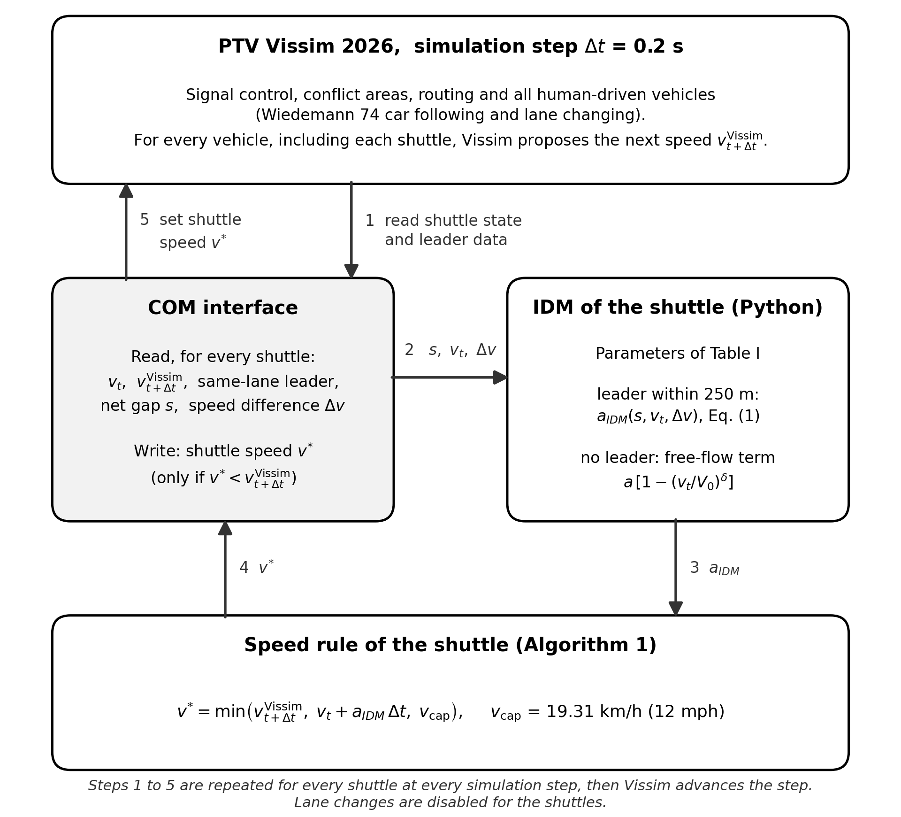
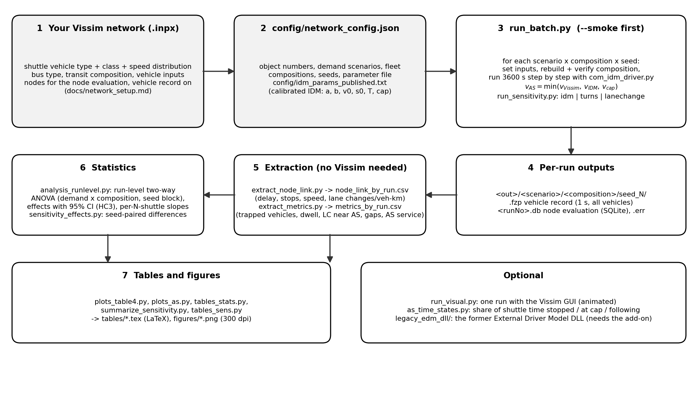

# Autonomous shuttles in PTV Vissim: a calibrated IDM driven through COM

Replication package for the evaluation of low-speed autonomous shuttles (AS) in
mixed traffic on a signalized arterial, as reported in

> A. Guerra, R. Favero and L. Elefteriadou, *Simulation-Based Traffic Impacts of
> Autonomous Shuttle Deployment on Urban Signalized Arterials*, IEEE Transactions
> on Intelligent Transportation Systems (under review, T-ITS-25-07-3670).

The method is independent of the network: the shuttle is driven by a
field-calibrated Intelligent Driver Model (IDM) through the Vissim COM
interface, one simulation step at a time, and everything that depends on the
network (object numbers, demand scenarios, fleet compositions) is read from a
single configuration file. No External Driver Model add-on is needed; COM is
part of the base Vissim license. The network used in the paper is not part of
the repository; `examples/archer_road/` holds the outputs it produced.

## How the shuttle is driven



At every simulation step (0.2 s) the script reads, for each shuttle, its speed
`v_t`, the speed Vissim proposes for the next step `v_Vissim`, and the nearest
vehicle ahead in the same lane within 250 m (net gap `s`, speed difference
`dv`). It evaluates the IDM acceleration with the calibrated parameters (free
road term alone when there is no leader) and sets the shuttle speed to

    v* = min( v_Vissim,  v_t + a_IDM * dt,  v_cap )

where `v_cap` is the operational speed limit of the deployment (12 mph in the
paper). The shuttle is therefore never faster than Vissim would make it: signal
control, conflict areas, stop lines, priority rules and routing stay with
Vissim, while the IDM governs the shuttle's acceleration, following distance and
free-flow speed. Shuttles never change lanes (lane attribute
`NoLnChL/RVehClasses` = shuttle class on every lane), like the predefined-route
operation of current deployments. The IDM parameters shipped with the
repository were calibrated and validated on field trajectories of a NAVYA
shuttle (Favero and Elefteriadou, 2025); replace them with your own calibration.

## Workflow



| Step | Script | What it produces |
|---|---|---|
| 1 | your network | see [docs/network_setup.md](docs/network_setup.md) |
| 2 | `config/network_config.json`, `config/idm_params_published.txt` | object numbers, demand scenarios, fleet compositions, seeds, IDM parameters |
| 3 | `run_batch.py --smoke`, then `run_batch.py` | one Vissim run per scenario x composition x seed |
| 3b | `run_sensitivity.py idm | turns | lanechange` | reduced grid for the sensitivity analysis |
| 4 | Vissim | `.fzp` vehicle record and the run's node-evaluation database, moved into `batch_results/<scenario>/<composition>/seed_N/` |
| 5 | `extract_node_link.py`, `extract_metrics.py` | `node_link_by_run.csv` (delay, stops, speed, lane changes per veh-km, per vehicle class) and `metrics_by_run.csv` (trajectory-level measures) |
| 6 | `analysis_runlevel.py`, `sensitivity_effects.py` | run-level two-way ANOVA, effects with 95 % confidence intervals, seed-paired sensitivity differences |
| 7 | `plots_table4.py`, `plots_as.py`, `tables_stats.py`, `summarize_sensitivity.py`, `tables_sens.py` | LaTeX tables and 300-dpi figures |

Steps 5 to 7 need only Python; they can run on any machine with a copy of the
output folders.

## Requirements

- Windows with PTV Vissim installed and licensed (developed and tested with
  Vissim 2026; earlier versions with the COM interface should work but were
  not tested).
- Python 3.10 or later and `pip install -r requirements.txt` (pywin32 for COM;
  numpy, pandas, scipy, statsmodels, matplotlib for the analysis).

## Quick start

```bat
git clone https://github.com/agustingu/Autonomous-Shuttle-Vissim-Integration.git
cd Autonomous-Shuttle-Vissim-Integration
pip install -r requirements.txt

rem 1. prepare the network (docs/network_setup.md) and put it in network\  (ignored by git)
rem 2. copy config\network_config.json, edit it for your network, then
set AS_CONFIG=C:\path\to\my_network_config.json
python config.py                      rem prints what the scripts will use

rem 3. simulate
python run_batch.py --smoke           rem composition read-back + one 600 s run; must end with "... -> OK"
python run_batch.py                   rem the full grid (resumable)
python run_sensitivity.py --check     rem read-back of every sensitivity variant, no simulation
python run_sensitivity.py idm
python run_sensitivity.py turns
python run_sensitivity.py lanechange

rem 4. extract (no Vissim needed from here on)
python extract_metrics.py             rem batch_results\metrics_by_run.csv, gaps_long.csv
python extract_node_link.py           rem batch_results\node_link_by_run.csv
for /d %f in (sensitivity_results\idm\* sensitivity_results\turns\* sensitivity_results\lanechange\*) do (
    python extract_metrics.py "%f" & python extract_node_link.py "%f")

rem 5. analyse
python analysis_runlevel.py           rem stats_runlevel_{anova,effects,slopes}.csv
python plots_table4.py                rem tables\table4*.tex, figures\{delay,stops,speed,lc,class_delay}.png
python plots_as.py                    rem figures\as_*.png, gap_*.png
python tables_stats.py                rem tables\table5_anova.tex, table6_effects.tex, figures\as_interaction.png
python summarize_sensitivity.py       rem tables\sensitivity_<family>.csv/.tex
python sensitivity_effects.py         rem tables\sensitivity_<family>_effects.csv/.tex
python tables_sens.py                 rem tables\table7_idm.tex, table8_turns_lc.tex
```

Two workers can simulate in parallel on one machine: give the second one its
own copy of the network with `set AS_NET=C:\path\to\copy.inpx` (own run
numbering, own `.results` folder) and let each run a different family or a
different output root.

## Repository layout

| Path | Content |
|---|---|
| `config.py` | loads the JSON configuration; the only module the scripts import for network-specific values |
| `config/network_config.json` | the Archer Road example configuration (edit a copy for your network) |
| `config/idm_params_published.txt` | calibrated IDM parameters of the shuttle and the operational speed cap |
| `config/idm_params_lowaccel.txt` | an alternative, non-calibrated set used only as a contrast in the sensitivity analysis |
| `com_idm_driver.py` | the step-by-step COM driver (the rule above, leader detection, lane-change restriction) |
| `run_batch.py` | the main experiment grid; `--smoke` for a first check |
| `run_sensitivity.py` | IDM-parameter, turning-share and lane-changing-parameter sensitivity families |
| `run_visual.py` | one run with the Vissim GUI visible, same driver, for watching |
| `extract_metrics.py` | trajectory-level measures from the `.fzp` vehicle record |
| `extract_node_link.py` | node delay and stops per vehicle class from the run database; link speeds and lane changes per veh-km from the `.fzp` |
| `analysis_runlevel.py` | run-level two-way ANOVA (demand x composition, seed block), effects with 95 % CI (HC3), per-N-shuttle slopes |
| `analysis_stats.py` | scenario-mean one-way ANOVA and paired tests (continuity with the first version of the study) |
| `summarize_sensitivity.py`, `sensitivity_effects.py` | cell means and seed-paired differences with 95 % CI for the sensitivity families |
| `plots_table4.py`, `plots_as.py`, `tables_stats.py`, `tables_sens.py` | LaTeX tables and figures |
| `as_time_states.py` | share of shuttle time stopped, at the cap, following or accelerating (why the network results are insensitive to moderate IDM changes) |
| `docs/` | `network_setup.md` (network checklist and configuration keys), `com_loop.png`, `workflow.png` |
| `examples/archer_road/` | per-run metrics, statistics, tables and figures of the paper's experiment (150 runs + 220 sensitivity runs) |
| `legacy_edm_dll/` | the former External Driver Model C++ implementation (needs the add-on; superseded, kept for reference) |

## Measures

Conventional (from the node evaluation and the vehicle record), per run:

- intersection delay and stops per vehicle, vehicle-weighted over the nodes, for all vehicles, buses and shuttles;
- speed: mean over the links of the space-mean speed of all vehicles;
- lane changes of the human-driven vehicles per vehicle-kilometre travelled (comparable across demand levels).

Trajectory-level measures of the AS-traffic interaction (from the vehicle record), per run:

- vehicles trapped behind a shuttle: a vehicle is trapped at a given second when its leader, or the leader of its leader along the same lane, is a shuttle; reported as distinct vehicles per hour and their mean dwell time (consecutive seconds in that state);
- lane changes near a shuttle: share of all lane-change events that start within 100 m upstream of a shuttle on the same link;
- follower gap (mean, median, 85th percentile) behind shuttles and behind buses;
- shuttle service: time in the network of the shuttles that complete their trip, mean speed, stops per trip.

## Statistics

`analysis_runlevel.py` treats each simulation run as one observation and fits,
for every measure, `y = demand scenario * fleet composition + seed`, with the
random seed as a blocking factor because the same seeds are reused in every
cell. It reports F tests with partial eta-squared for demand, composition and
their interaction (the design is balanced, so the attribution of sums of
squares does not depend on the order of the effects), contrasts of the fitted
model with 95 % confidence intervals on heteroscedasticity-consistent (HC3)
standard errors (full replacement of the buses, per demand level and averaged;
all pairwise compositions, Holm-adjusted within each measure), and the linear
effect of the AS share per `N` shuttles added (the smallest composition step).
AS-specific measures, undefined without shuttles, use the compositions that
contain shuttles.

`sensitivity_effects.py` reports, for each variant, the seed-paired difference
to the reference (variant minus calibrated case for the IDM family; the AS
effect, all-AS minus no-AS fleet, under the variant and its difference to the
AS effect in the main batch for the turning and lane-changing families) as the
mean and the t-based 95 % confidence interval over the seeds.

## The Archer Road experiment (examples/archer_road)

One direction of Archer Road, Gainesville, Florida: three signalized
intersections, six demand levels (1115 to 2333 veh/h entering), 20 transit
vehicles per hour in five AS/bus compositions (0/20 to 20/0), five seeds, one
hour per run. Headline results of the run-level analysis: full replacement of
the buses raises intersection delay by 1.4 s/veh (7 %) at the lowest demand and
9.2 s/veh (20 %) at the highest, raises lane changes by 0.25 per veh-km at
every demand level, and every five shuttles added trap on average 108
additional vehicles per hour behind a shuttle. The network results are robust
to +/-25 % changes of the IDM parameters (the shuttle is stopped or at its cap
about 70 % of its time) but not to a markedly lower acceleration capability.
`examples/archer_road/` contains the per-run CSV files, the statistics and the
generated tables and figures, so the analysis stage can be re-run without
Vissim:

```bat
set AS_CONFIG=config\network_config.json
python analysis_runlevel.py examples\archer_road
python tables_stats.py examples\archer_road
```

## Citing

If you use this code, please cite the paper above and the calibration study:

- R. Favero and L. Elefteriadou, "Exploratory driving performance and car-following modeling for autonomous shuttles based on field data", *IEEE Transactions on Intelligent Transportation Systems*, vol. 26, no. 5, pp. 6042-6055, 2025, doi:10.1109/TITS.2025.3552506.
- M. Treiber, A. Hennecke and D. Helbing, "Congested traffic states in empirical observations and microscopic simulations", *Physical Review E*, vol. 62, pp. 1805-1824, 2000 (the IDM).
- A. Kesting and M. Treiber, "Calibrating car-following models by using trajectory data: methodological study", *Transportation Research Record*, no. 2088, pp. 148-156, 2008.

Contact: Agustin Guerra, INDICATIC AIP (aguerra@indicatic.org.pa).
